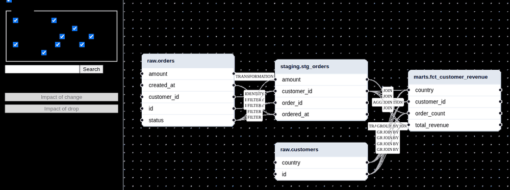
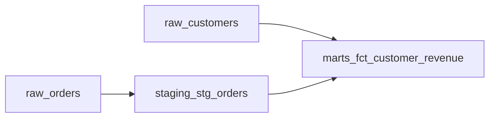

# LineageLens — Column-level SQL lineage, impact analysis, viewer, and agent

[](https://github.com/dnanatihor/lineagelens/actions/workflows/ci.yml)
[](LICENSE)
[](https://pypi.org/project/lineagelens/)



## Why

Warehouse teams need to know which columns change value, and which statements stop compiling, when an upstream column changes or disappears. Single-statement parsers stop at one query, so cross-file impact is still traced by hand. LineageLens builds a project-wide column graph with typed direct and indirect edges so those two questions stay distinct, and every agent claim points at a file and line.

## Quickstart

```bash
uv run --frozen lineagelens build tests/fixtures/warehouse -o graph.json && uv run --frozen lineagelens impact graph.json --drop raw.orders.status && uv run --frozen lineagelens export graph.json --format mermaid --level table
```

Requires [uv](https://docs.astral.sh/uv/) and the repository checkout. `graph.json` is the warehouse fixture graph.

## How it works

```mermaid
flowchart LR
  sources[SQL files and dbt] --> extract[sqlglot extraction]
  extract --> graph[Column graph]
  graph --> impact[Impact and exports]
  graph --> viewer[Viewer]
  graph --> agent[ReAct agent]
```

`lineagelens build` parses SQL and optional dbt `target/manifest.json`, records diagnostics instead of aborting, and writes a column graph. `impact` answers a value change and a drop separately. `serve` opens the viewer. `ask` runs the agent with `LINEAGELENS_MODEL` (default `openai:gpt-4.1-mini`); it may only repeat tool results.

## Results / example output

`lineagelens impact --drop raw.orders.status` on `tests/fixtures/warehouse`:

```text
failing statements:
  01_stg_orders.sql#0
broken tables:
  staging.stg_orders
  marts.fct_customer_revenue
evidence:
  01_stg_orders.sql:1 raw.orders.status -> staging.stg_orders.amount
  01_stg_orders.sql:1 raw.orders.status -> staging.stg_orders.customer_id
  01_stg_orders.sql:1 raw.orders.status -> staging.stg_orders.order_id
  01_stg_orders.sql:1 raw.orders.status -> staging.stg_orders.ordered_at
```

`lineagelens export --format mermaid` on the same graph:



## Design decisions

- [Column name normalisation](docs/adr/0001-column-fqn-normalisation.md)
- [Separate change and drop impact](docs/adr/0002-impact-result-types.md)

## Roadmap

- Server-side subgraph extraction for graphs past the viewer collapse threshold.

## Licence

Apache-2.0
